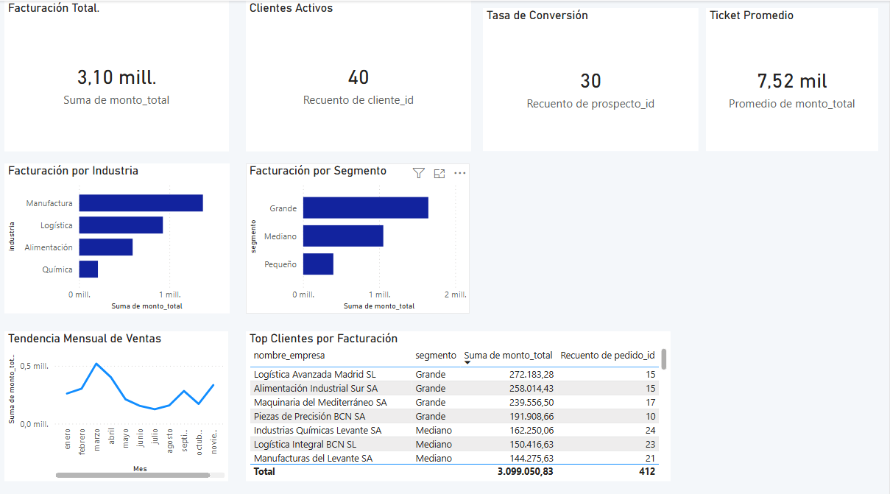
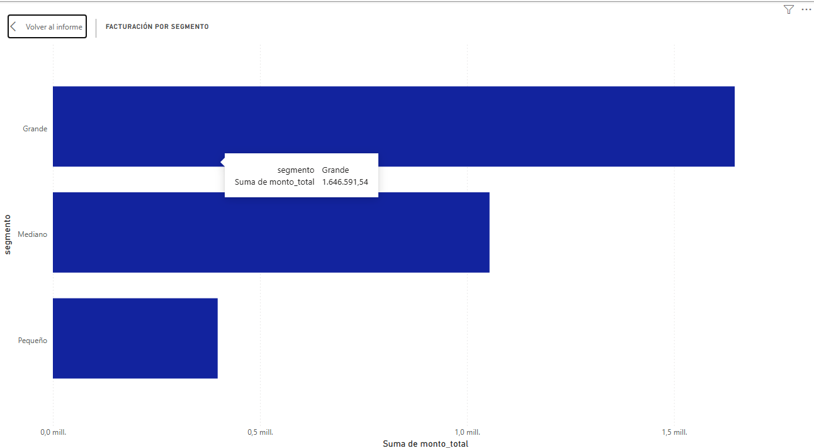
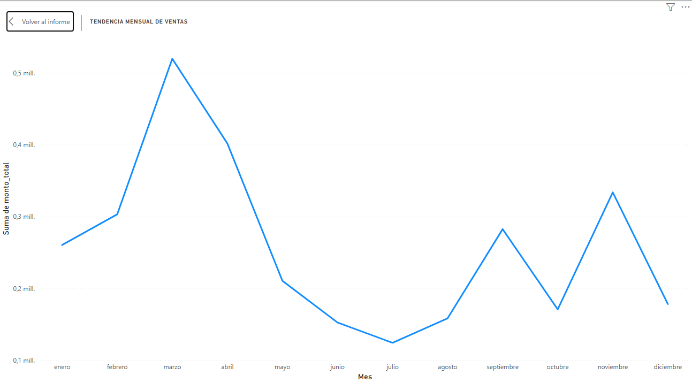

# Análisis Comercial B2B — SQL + Power BI 📊

## ¿Qué clientes B2B valen más y cuáles se están enfriando?

Análisis de una cartera de clientes B2B, desde el dataset hasta el tablero ejecutivo: segmentación RFM, cohortes de retención y KPIs comerciales.

## Dataset
Dataset **sintético** B2B generado en Python (los datos comerciales reales son sensibles y no se publican):
- 5 tablas relacionales: clientes, productos, pedidos, detalle de pedidos y prospectos
- 1.747 registros en total · 40 clientes con pedidos completados

## Herramientas
- **SQL** — consultas de análisis. Las de RFM y cohortes están en dialecto SQLite para que cualquiera pueda ejecutarlas con `run_analisis.py` (en T-SQL cambian solo las funciones de fecha).
- **Power BI** — tablero interactivo
- **Python** (pandas, sqlite3) — generación del dataset y ejecución reproducible de las consultas

## Segmentación RFM
Cada cliente se puntúa del 1 al 5 en tres dimensiones, con quintiles (`NTILE(5)`):
- **Recency:** días desde su último pedido completado (más reciente = mejor puntuación)
- **Frequency:** número de pedidos completados
- **Monetary:** facturación total

Con la puntuación de recencia y frecuencia se asigna un segmento accionable. Resultado (`salidas/rfm_resultado.csv`):

| Segmento | Clientes | % de la facturación |
|---|---|---|
| Campeones | 10 | 40,1% |
| Leales | 6 | 29,0% |
| En riesgo | 8 | 16,1% |
| Hibernando / Perdidos | 8 | 7,1% |
| Nuevos / Potenciales | 5 | 6,0% |
| Necesitan atención | 3 | 1,7% |

**Hallazgo:** 16 de 40 clientes (Campeones y Leales) concentran el **69% de la facturación**, y hay 8 clientes "en riesgo" que suman otro 16%: son los primeros a los que conviene llamar.

## Cohortes de retención
- **Cohorte:** trimestre de alta del cliente (`fecha_alta`).
- **Retención:** porcentaje de clientes de la cohorte con al menos un pedido completado en cada trimestre posterior.
- Como la cohorte se define por el alta y no por la primera compra, el trimestre 0 puede no llegar al 100%: mide cuántos compraron el mismo trimestre en que se dieron de alta.
- Las cohortes son pequeñas (de 2 a 9 clientes), así que cada porcentaje se mueve mucho con un solo cliente: sirven para ver tendencias, no para conclusiones finas.

Resultado completo en `salidas/cohortes_resultado.csv`.

## Tablero en Power BI
Además del RFM y las cohortes, el tablero muestra la segmentación por industria y tamaño, la tendencia mensual de ventas, los clientes que más facturan, la facturación por segmento y la conversión de prospectos.

### Vista general


### Facturación por segmento


### Tendencia mensual de ventas


## Estructura del proyecto
```
proyecto1-analisis-b2b/
├── datos/        # Los 5 CSV del dataset sintético
├── sql/
│   ├── 03_queries_analisis.sql     # Productos más vendidos por categoría
│   ├── 04_rfm_segmentacion.sql     # Segmentación RFM
│   ├── 05_cohortes_retencion.sql   # Cohortes de retención trimestral
│   └── run_analisis.py             # Ejecuta 04 y 05 y exporta los resultados
├── salidas/      # Resultados de RFM y cohortes (CSV listos para Power BI)
├── dashboard/    # Archivo de Power BI (.pbix)
└── imagenes/     # Capturas del tablero
```

## Cómo reproducirlo
```bash
cd sql
python3 run_analisis.py
```
Carga los CSV en una base SQLite en memoria, ejecuta las consultas de RFM y cohortes, imprime los resultados y los guarda en `salidas/`.

## Contacto
**Lucas Espinosa** — Data Analyst
[LinkedIn](https://linkedin.com/in/lucasespinosaa) · lucaseespinosa93@gmail.com · [github.com/lucasees](https://github.com/lucasees)
